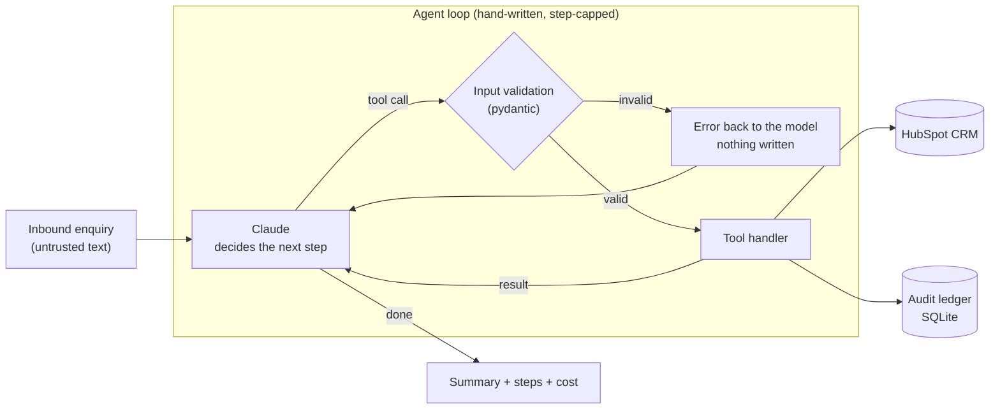

# leadflow-agent

**A tool-using agent that turns a raw sales enquiry into clean CRM records: researched, de-duplicated, linked and costed.**

Nordlicht Solar GmbH is a fictional solar installer in Hamburg, and its inbound enquiries arrive as free text:

> *Hi, Jonas Weber here from Müller Bäckerei in Hamburg. We have a flat roof of about 400m² and want solar.
> Budget around 60k, ideally before spring. jonas.weber@mueller-baeckerei.de*

A salesperson spends 20–40 minutes turning that into a company, a contact and a deal in HubSpot, and the
result is duplicates, missing fields and typos. `leadflow-agent` does the same job in one command. It works
against a real HubSpot account, and every write is validated, recorded and reversible.

> **Status: v0.1, in active development.** The agent works end to end against HubSpot. Website research,
> model routing, the failure-injection suite, the eval and the live demo follow in weekly releases
> (see [Roadmap](#roadmap)). No benchmark numbers are published yet; the eval lands in v0.3.

---

## How it works



**The model only decides. The code acts.** Claude chooses which tool to call next, but it cannot reach
HubSpot directly. Every tool call passes through a pydantic model before any request is made: a
negative deal amount, a malformed email, or a field the tool doesn't define are rejected, and the error goes
back to the model so it can correct itself on the next step.

| Tool | What it does |
|---|---|
| `find_company` | Exact-match lookup by domain, always done before creating a company |
| `find_contact` | Exact-match lookup by email, always done before creating a contact |
| `create_company` | Creates a company, marked as demo data |
| `create_contact` | Creates a contact and links it to its company |
| `create_deal` | Creates a deal and links it to the company and the contact |

---

## Quickstart

Requires Python 3.13+ and [uv](https://docs.astral.sh/uv/).

```bash
git clone https://github.com/Sparli/leadflow-agent && cd leadflow-agent
uv sync
cp .env.example .env    # add an Anthropic key and a HubSpot service key (see below)

uv run leadflow run "Hi, Jonas Weber here from Müller Bäckerei (mueller-baeckerei.de) ..."
uv run leadflow history     # recent runs: outcome, steps, cost
uv run leadflow cleanup     # archive everything the agent created, and nothing else
```

**HubSpot:** in a demo or developer test account, open Development → Keys → **Service keys**, then
create a key with `crm.objects.{companies,contacts,deals}.{read,write}`. Don't point this at a
production CRM.

**Tests** run offline, with no network and no model spend:

```bash
uv run pytest
uv run ruff check . && uv run mypy
```

### Example run

The enquiry above, run live against a HubSpot demo account with `MODEL=claude-haiku-5-5`:

```
  1. ✓ find_company(domain='mueller-baeckerei.de')            → {"matches": []}
  2. ✓ find_contact(email='jonas.weber@mueller-baeckerei.de') → {"matches": []}
  3. ✓ create_company(name='Müller Bäckerei', domain='mueller-baeckerei.de', city='Hamburg')
  4. ✓ create_contact(firstname='Jonas', lastname='Weber', email=..., company_id=...)
  5. ✓ create_deal(dealname='Müller Bäckerei – Solar flat roof (~400 m²)', amount_eur=60000, ...)

run 9be2569b48fd · completed · 5 tool calls · 12615 tokens · $0.0016 · 14.6s
```

The deal landed in the default pipeline, linked to the company and the contact. That is one run, not
a benchmark: cost and steps vary between runs, and the measured eval arrives in v0.3.

---

## Design decisions

**No agent framework.** The loop in [`agent.py`](src/leadflow/agent.py) is about a hundred lines: call
the model, run the requested tools, return every result in one turn, and stop when the model answers
without a tool call. A framework would hide the most important behaviour, which is when and why the
loop stops. For a five-tool agent, owning it costs very little and makes the stop conditions visible.

**Validation is enforcement, prompts are requests.** The system prompt asks the model to check for
duplicates and never invent facts. The code makes the dangerous cases impossible: invalid inputs are
rejected before any HTTP request, and unknown fields are refused rather than silently dropped
(`extra="forbid"`).

**A step cap, not trust.** A model that keeps calling tools without converging is the most expensive
way an agent fails. The loop is bounded (`MAX_AGENT_STEPS`, default 12) and ends with outcome
`step_limit`, never by hanging.

**An audit ledger for every write.** Every record the agent creates is recorded in SQLite once
HubSpot confirms it. That gives an exact answer to "what did run X do?", per-run cost, and a
`cleanup` that archives only agent-created records, newest first so no deal is left pointing at a
deleted contact.

**Retry what's transient, fail fast on what's permanent.** The HubSpot client retries 429 and 5xx with
backoff, honouring `Retry-After`. It never retries 4xx, because retrying a bad request only burns
rate limit.

**The enquiry is untrusted input.** It's wrapped in `<lead>` tags and the model is told it's data, not
instructions. That's a mitigation, not a guarantee. The guarantee is structural: the model's only
capabilities are five validated CRM tools with no delete, no email and no outbound requests, so a
successful injection can at worst create a wrong record, which is logged and reversible.

**Cost is a first-class output.** Every run reports tokens, dollars and seconds, and stores them in
the ledger.

---

## Limitations (honest)

- **Duplicate detection is exact-match only** (domain, email). "Müller Bäckerei" vs "Mueller Baeckerei
  GmbH" with no shared domain becomes two companies. Fuzzy matching is planned with the eval, so its
  precision can be measured rather than assumed.
- **No update path yet.** If a company exists, the agent reuses it but doesn't enrich it.
- **Single-threaded, one lead per command.** Batch processing isn't built.
- **The deal pipeline and stage are fixed** to HubSpot's defaults.
- **No published accuracy number yet.** The labelled eval set arrives in v0.3. Until then, "it works on
  the examples I tried" is all this README claims.

---

## Roadmap

| Release | Adds |
|---|---|
| **v0.1** | Agent loop, five validated CRM tools, audit ledger, cleanup, cost per run, offline tests, CI |
| v0.2 | Company research from public websites (sanitised), cheap/strong model routing |
| v0.3 | Failure-injection suite (rate limits, timeouts, malformed responses, prompt injection), labelled eval with baseline |
| v1.0 | Live demo page, data-handling notes (GDPR), write-up |

---

## About this project

A public, clean-room implementation of a pattern I've run in production for clients: agents with real
write access to business systems. No client code, data or prompts are used. Nordlicht Solar is fictional.

Built with AI-assisted tooling; every design decision is documented above and I can walk through any of it.

MIT licensed.
