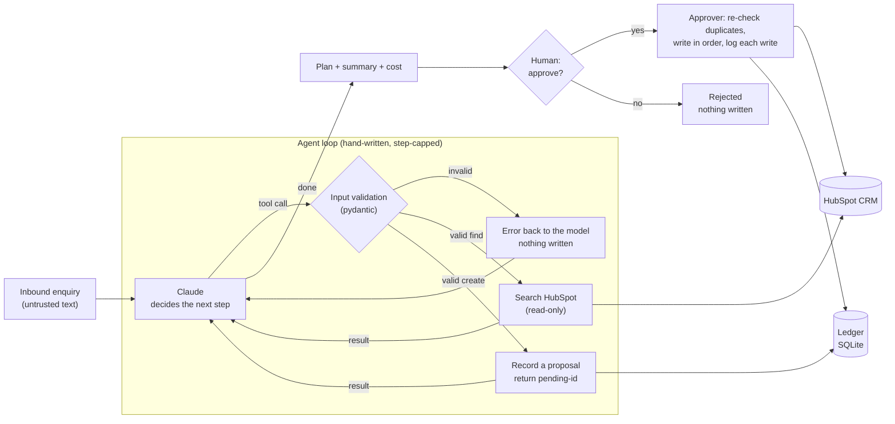

# leadflow-agent

**A tool-using agent that turns a raw sales enquiry into a plan of clean CRM records: de-duplicated, linked, costed, and written only after a human approves.**

Nordlicht Solar GmbH is a fictional solar installer in Hamburg, and its inbound enquiries arrive as free text:

> *Hi, Jonas Weber here from Müller Bäckerei in Hamburg. We have a flat roof of about 400m² and want solar.
> Budget around 60k, ideally before spring. jonas.weber@mueller-baeckerei.de*

A salesperson spends 20–40 minutes turning that into a company, a contact and a deal in HubSpot, and the
result is duplicates, missing fields and typos. `leadflow-agent` does the same job in one command. It works
against a real HubSpot account: the agent proposes, a human approves, and every write is validated,
recorded and reversible.

> **Status: v0.2, in active development.** The agent works end to end against HubSpot, with a human
> approval step before any write. The failure-injection suite, the eval and the live demo follow
> (see [Roadmap](#roadmap)). No benchmark numbers are published yet; the eval lands in v0.3.

---

## How it works



**The model only decides. The code acts, and only after a human says yes.** Claude chooses which tool
to call next, but it cannot write to HubSpot at all: the create tools record a proposal and hand back a
placeholder id (`pending-4`) that the model uses to link later records. Every tool call passes through a pydantic model before any request is made: a
negative deal amount, a malformed email, or a field the tool doesn't define are rejected, and the error goes
back to the model so it can correct itself on the next step.

| Tool | What it does |
|---|---|
| `find_company` | Exact-match lookup by domain, always done before creating a company |
| `find_contact` | Exact-match lookup by email, always done before creating a contact |
| `create_company` | Proposes a company, marked as demo data |
| `create_contact` | Proposes a contact linked to its company |
| `create_deal` | Proposes a deal linked to the company and the contact |

---

## Quickstart

Requires Python 3.13+ and [uv](https://docs.astral.sh/uv/).

```bash
git clone https://github.com/Sparli/leadflow-agent && cd leadflow-agent
uv sync
cp .env.example .env    # add an Anthropic key and a HubSpot service key (see below)

uv run leadflow run "Hi, Jonas Weber here from Müller Bäckerei (mueller-baeckerei.de) ..."
                            # shows the plan and asks before writing; --yes approves without asking
uv run leadflow approve <run-id>   # write a pending plan; safe to repeat after a failure
uv run leadflow reject <run-id>    # discard it; nothing is written
uv run leadflow history     # recent runs: outcome, steps, cost, anything awaiting approval
uv run leadflow cleanup     # archive everything the agent created, and nothing else
```

**HubSpot:** in a demo or developer test account, open Development → Keys → **Service keys**, then
create a key with `crm.objects.{companies,contacts,deals}.{read,write}`. Don't point this at a
production CRM.

**Tests** run offline, with no network and no model spend:

```bash
uv run pytest
uv run ruff check . && uv run mypy
```

### Example run

A new enquiry, run live against a HubSpot demo account with `MODEL=claude-haiku-5-5`:

```
  1. ✓ find_company(domain='hansen-logistik.de')              → {"matches": []}
  2. ✓ find_contact(email='anke.hansen@hansen-logistik.de')   → {"matches": []}
  3. ✓ create_company(name='Hansen Logistik', ...)            → {"company_id": "pending-4", ...}
  4. ✓ create_contact(firstname='Anke', ..., company_id='pending-4')  → {"contact_id": "pending-5", ...}
  5. ✓ create_deal(..., company_id='pending-4', contact_id='pending-5', amount_eur=250000)

run ae2bba75946a · completed · 5 tool calls · 13828 tokens · $0.0018 · 10.24s

Plan (nothing has been written yet):
  pending-4    company  Hansen Logistik (hansen-logistik.de)
  pending-5    contact  Anke Hansen <anke.hansen@hansen-logistik.de> → company pending-4
  pending-6    deal     Hansen Logistik – Solar + Battery, Billbrook warehouse  €250,000 → company pending-4, contact pending-5

$ leadflow approve ae2bba75946a
  ✓ created company  352411267773
  ✓ created contact  569643909826
  ✓ created deal     354427418302
```

Running an already-processed enquiry again, the agent found the existing company and contact and
proposed only a new deal, which was a duplicate deal, so it was rejected at the approval step. That is
one run each, not a benchmark: cost and steps vary, and the measured eval arrives in v0.3.

---

## Design decisions

**No agent framework.** The loop in [`agent.py`](src/leadflow/agent.py) is about a hundred lines: call
the model, run the requested tools, return every result in one turn, and stop when the model answers
without a tool call. A framework would hide the most important behaviour, which is when and why the
loop stops. For a five-tool agent, owning it costs very little and makes the stop conditions visible.

**Validation is enforcement, prompts are requests.** The system prompt asks the model to check for
duplicates and never invent facts. The code makes the dangerous cases impossible: invalid inputs are
rejected before any HTTP request, and unknown fields are refused rather than silently dropped
(`extra="forbid"`).

**Propose, then approve.** Cleanup can undo a record, but not what happened while it existed: a
salesperson called the lead, a workflow sent an email. So the agent never writes. Its plan sits in the
ledger until `approve` or `reject`. Approval executes in order, swapping placeholders for real ids,
**re-checks duplicates** (time has passed since the agent looked), stops at the first failure, and
resumes on retry without creating anything twice: a record's id is saved the moment HubSpot returns
it, before its links are made.

**Ids only come from tools.** A link can only point at an id this run found or proposed. An id copied
from the enquiry text is rejected, so an injected "attach this to company 12345" cannot reach someone
else's record. The same layer enforces that a deal links the run's contact: in a live run, a model
proposing the contact and deal in one parallel step left the deal linked to nobody. A prompt line asks
for sequential calls; the code makes the bad plan impossible.

**A step cap, not trust.** A model that keeps calling tools without converging is the most expensive
way an agent fails. The loop is bounded (`MAX_AGENT_STEPS`, default 12) and ends with outcome
`step_limit`, never by hanging.

**An audit ledger for every write.** Every record the agent creates is recorded in SQLite once
HubSpot confirms it. That gives an exact answer to "what did run X do?", per-run cost, and a
`cleanup` that archives only agent-created records, newest first so no deal is left pointing at a
deleted contact.

**Retry what's transient and safe, fail fast on the rest.** Reads are retried on 429, 5xx and network
errors with backoff, honouring `Retry-After`. A create is retried only on 429 or a connection that never
opened: after a 5xx or a timeout the record may already exist, and a blind retry would duplicate it.
4xx is never retried.

**The enquiry is untrusted input.** It's wrapped in `<lead>` tags and the model is told it's data, not
instructions. That's a mitigation, not a guarantee. The guarantee is structural: the model's only
capabilities are five validated CRM tools with no delete, no email and no outbound requests, so a
successful injection can at worst propose a wrong record, which a human sees before it is written.

**Cost is a first-class output.** Every run reports tokens, dollars and seconds, and stores them in
the ledger.

---

## Failure modes

Every failure the system is designed for (HubSpot outages, lost responses, hostile enquiries, a
model that loops) has a row in [FAILURE-MODES.md](FAILURE-MODES.md) and a test in
[`tests/test_failures.py`](tests/test_failures.py). The rule that shapes most of them: **retry a
read whenever it fails; retry a write only when it certainly did not happen.**

---

## Limitations (honest)

- **Duplicate detection is exact-match only** (domain, email). "Müller Bäckerei" vs "Mueller Baeckerei
  GmbH" with no shared domain becomes two companies. Fuzzy matching is planned with the eval, so its
  precision can be measured rather than assumed.
- **No update path yet.** If a company exists, the agent reuses it but doesn't enrich it. A reused
  contact is not re-linked to a different company.
- **No duplicate check for deals.** Re-running an enquiry proposes a second deal; today the human
  approval step is what catches it.
- **Approval is a CLI prompt.** No web UI, notifications or approval timeout yet.
- **Single-threaded, one lead per command.** Batch processing isn't built.
- **The deal pipeline and stage are fixed** to HubSpot's defaults.
- **No published accuracy number yet.** The labelled eval set arrives in v0.3. Until then, "it works on
  the examples I tried" is all this README claims.

---

## Roadmap

| Release | Adds |
|---|---|
| v0.1 | Agent loop, five validated CRM tools, audit ledger, cleanup, cost per run, offline tests, CI |
| **v0.2** | Propose-then-approve: no write without a human yes; resumable approval; id provenance checks |
| v0.3 | Failure-injection suite (rate limits, timeouts, malformed responses, prompt injection), labelled eval with baseline, cheap/strong model routing |
| v1.0 | Live demo page, data-handling notes (GDPR), write-up |

---

## About this project

A public, clean-room implementation of a pattern I've run in production for clients: agents with real
write access to business systems. No client code, data or prompts are used. Nordlicht Solar is fictional.

Built with AI-assisted tooling; every design decision is documented above and I can walk through any of it.

MIT licensed.
